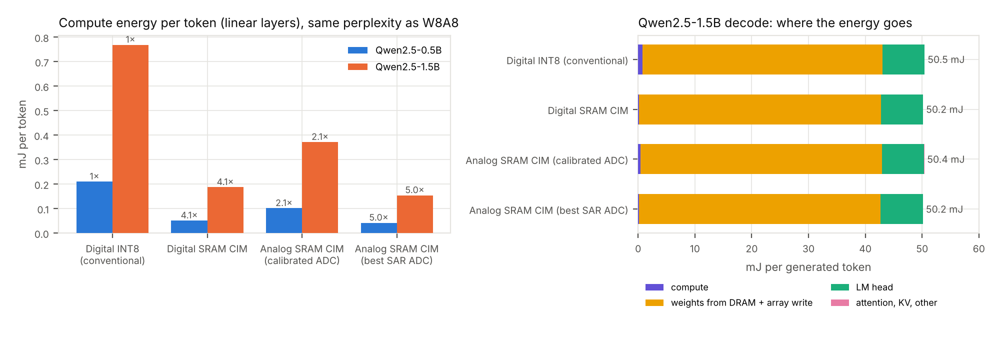
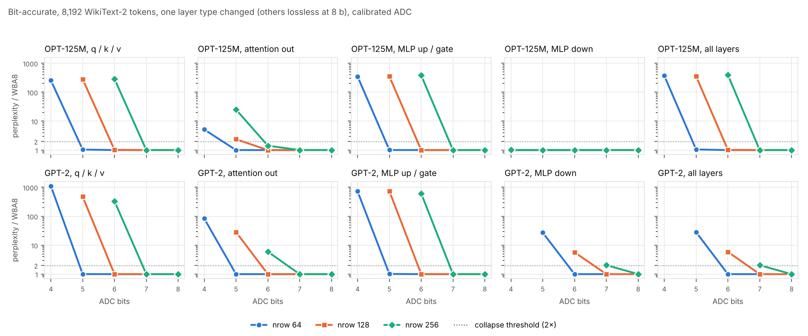
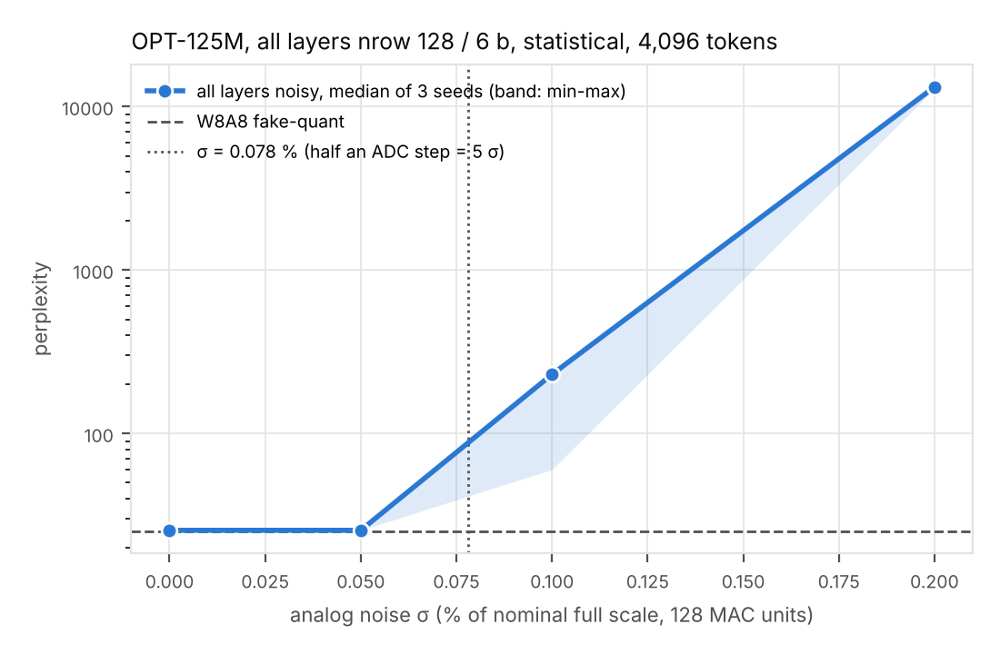

# cimsim: SRAM compute-in-memory simulator for LLM inference

`cimsim` answers two questions for a small language model running on SRAM compute-in-memory (CIM) hardware:

1. **Does the model still work?** Perplexity and zero-shot accuracy with analog non-idealities: ADC precision,
   rows summed per conversion, analog noise, activation outliers.
2. **What does it cost?** Energy, latency and area per token, split into prefill and decode, for the whole
   system: CIM arrays, ADCs, digital units, on-chip buffers and DRAM.

It takes a HuggingFace decoder model (OPT, GPT-2, Llama, Qwen2), swaps its linear layers (and optionally its
attention matmuls) for simulated CIM layers, and counts every hardware event while the model runs. The event
counts are then multiplied by per-event costs calibrated on published silicon. No existing open tool does
both halves for decoder LLMs: ASiM simulates accuracy only, CiMLoop / AccelForge cost energy only, and
NeuroSim does not model prefill / decode or the KV cache.

## Headline result



Qwen2.5-1.5B and Qwen2.5-0.5B, 8-bit weights and activations, 22 nm / 0.8 V, sequence length 512. The
conventional baseline is a digital INT8 accelerator on the same node, with weights read from an on-chip SRAM
buffer. All four options give the same perplexity (within 0.2 % of W8A8).

| Qwen2.5-1.5B, energy per token | Digital INT8 (conventional) | Digital SRAM CIM | Analog SRAM CIM | Analog SRAM CIM, best SAR ADC |
|---|---|---|---|---|
| Compute (linear layers) | 0.77 mJ | 0.19 mJ | 0.37 mJ | 0.15 mJ |
| vs conventional | 1× | 4.1× lower | 2.1× lower | 5.0× lower |
| Prefill token (total) | 0.87 mJ | 0.29 mJ | 0.47 mJ | 0.26 mJ |
| Decode token (total) | 50.5 mJ | 50.2 mJ | 50.4 mJ | 50.2 mJ |
| Perplexity, WikiText-2 (8,192 tokens) | 10.338 | 10.338 | 10.342 | 10.342 |

What this shows:

- **Analog SRAM CIM cuts compute energy 2–5× against a conventional INT8 datapath, with no accuracy loss.**
  With the ADC of a published macro, the ADC is 63 % of the analog compute energy, so the ADC decides how much
  of the gain is kept.
- **Prefill benefits directly.** The weights loaded for a prompt are shared by all its tokens, so a prompt
  token costs 0.26–0.47 mJ on CIM against 0.87 mJ on the INT8 baseline.
- **Decode does not benefit, whatever the compute macro.** A 1.5B model (10.5 Gbit of 8-bit weights) does not
  fit on an edge chip. Every generated token re-reads the weights from DRAM: 41.6 mJ of weights plus 7.4 mJ for
  the LM head, against 0.37 mJ of CIM compute. That is about 99 % of the decode energy, and it caps decoding at
  about 8 tokens/s on one 12.8 GB/s memory channel (about 0.4 W).
- **Memory is the lever for decode.** 2 Gbit of weights on chip lowers decode energy 16 % (42.5 mJ).
  All weights on chip gives 7.8 mJ, but needs about 2,160 mm² of SRAM cells at 22 nm. GDDR5-class DRAM instead of
  HBM-class raises decode to 174 mJ.
- Qwen2.5-0.5B shows the same pattern: compute 0.21 mJ (INT8) vs 0.10 / 0.04 mJ (analog CIM), decode
  16.1 mJ per token.

These are model estimates, not chip measurements. How they were checked is under [Validation](#validation).
Details: [`docs/part_b_results.md`](docs/part_b_results.md).

## Accuracy on analog CIM

**A 6-bit ADC per 128 rows, with its full scale calibrated, adds no measurable loss over 8-bit digital
inference.** Full WikiText-2 test set, every linear layer on analog CIM:

| Model | FP32 | W8A8 digital | Analog SRAM CIM |
|---|---|---|---|
| Qwen2.5-0.5B | 13.069 | 13.332 | 13.329 |
| TinyLlama-1.1B | 7.707 | 7.793 | 7.793 |
| Qwen2.5-1.5B | 9.264 | 9.487 | 9.492 |

Zero-shot accuracy (ARC-e, PIQA, HellaSwag) stays within 0.8 pp of W8A8 on all three models. No difference is
statistically significant (paired test per question).


**Where it breaks.** A layer works when the ADC can resolve single MAC units: 2^b − 1 ≥ nrow / 2 for most
layers (6 bits for 128 rows, 5 bits for 64). One bit below that, perplexity rises 250–1,100×.



**Which layers need more bits** is set by how often the high input bit planes are 1, not by the size of
activation outliers. GPT-2's post-GELU projection is mostly small negative values, which set every high
bit in two's complement, so it needs one ADC bit more:


**Fix at no ADC cost:** rotating that layer's input with a Hadamard transform removes the extra bit. Moving the
layer to digital CIM or adding one ADC bit also works, at a higher cost:


**Analog noise** has a threshold. Noise below half an ADC step (σ ≤ 0.05 % of full scale) is absorbed exactly.
At 0.10 % the model degrades sharply.



Details: [`docs/part_a_results.md`](docs/part_a_results.md).

## How it works

```
HuggingFace model ──► swap Linear / attention ──► CIM layers ──► perplexity, zero-shot accuracy
                                                       │
                                                       ▼
                                                 event counts ──► × calibrated per-event costs
                                                 (ADC conversions,      (array, ADC, shift-add,
                                                  array cycles, MACs,     DRAM, buffers, digital units)
                                                  weight / KV writes)            │
                                                                                 ▼
                                                      energy / latency / area per token, prefill and decode
```

- **Bit-accurate mode.** Weights are bit-sliced into the array and inputs are applied bit-serially. Rows are
  summed in groups of `nrow`, each sum goes through a b-bit ADC with optional noise, then a digital shift-add.
  This mode matches ASiM to ≤ 1e-6 per layer.
- **Statistical (fast) mode.** The error is computed analytically from a calibration histogram, with an exact
  sparse term for ADC saturation and rare noise flips. It is 6–55× faster and agrees with bit-accurate mode
  within 2 %, which is what makes 1.5B models feasible on a CPU. It is valid where every calibrated ADC step is
  1/n of a MAC unit; the run script flags any other case.
- **Cost model.** Per-event energies come from three published SRAM CIM macros (65 nm, 22 nm, 7 nm), scaled
  to the target node. A mapper places weights in arrays under an on-chip budget, and the system model adds
  DRAM traffic for weights that do not fit, the KV cache (buffer or arrays), and digital non-linear units.

## Validation

| Check | Result | Where |
|---|---|---|
| Layer outputs vs ASiM | ≤ 1e-6 relative error, 7 linear + 14 conv configs | `tests/test_asim_equivalence.py` |
| ResNet-20 CIFAR-10 vs ASiM, 13 configs | within 0.8 % at ADC ≥ 8 b, within run-to-run spread below | [`validation/asim_repro.md`](validation/asim_repro.md) |
| Statistical vs bit-accurate mode | within 2 % on six configs incl. noise | `results/a3_gate_summary.md` |
| Energy model vs published macros (Jia JSSC'20, Sinangil JSSC'21, Chih ISSCC'21) | within 13 % in the operating range; 3 stated exceptions | [`validation/macro_calibration.md`](validation/macro_calibration.md) |
| Energy model vs AccelForge (CiMLoop) on the Jia macro | within 4.5 % | [`validation/tool_comparison.md`](validation/tool_comparison.md) |
| Event counts derived from model shape vs counted in a decode trace | equal, 17 of 17 checks | `results/b3_trace_qwen15b/` |

## Install (CPU)

```bash
python -m venv .venv
# Windows: .venv\Scripts\activate    Linux/macOS: source .venv/bin/activate
pip install torch --index-url https://download.pytorch.org/whl/cpu
pip install -e ".[llm,eval,dev]"
pytest -q
```

No GPU is needed; everything in this repository was run on a laptop CPU. [`docs/cpu_guide.md`](docs/cpu_guide.md)
has speeds and run budgets. The ASiM equivalence tests run only when ASiM is cloned
(`git clone https://github.com/Keio-CSG/ASiM third_party/ASiM`); otherwise they are skipped.

## Quick start

Perplexity of Qwen2.5-0.5B with every linear layer on analog CIM (statistical mode, calibrated 6-bit ADC):

```bash
python scripts/run_ppl.py --model Qwen/Qwen2.5-0.5B --config config/experiments/a4_stat_adc6cal.yaml \
    --name my_qwen05b_cim --max-tokens 8192 --threads 8
```

The same with the 8-bit digital reference, for comparison:

```bash
python scripts/run_ppl.py --model Qwen/Qwen2.5-0.5B --config config/experiments/e0_w8a8.yaml \
    --name my_qwen05b_w8a8 --max-tokens 8192 --threads 8
```

Energy, latency and area per token for a finished run (no model is loaded):

```bash
python scripts/run_ppa.py --run my_qwen05b_cim --shape config/models/qwen2.5-0.5b.yaml --name my_qwen05b_ppa
```

Each run writes `results/<name>/` with the result, the config, the git commit and the event counts.

Zero-shot accuracy:

```bash
python scripts/run_zeroshot.py --model Qwen/Qwen2.5-0.5B --config config/experiments/a4_stat_adc6cal.yaml \
    --name zs_my_run --limit 1000 --threads 8
```

Bit-accurate mode (slow on CPU; use small models and a token subset):

```bash
python scripts/run_ppl.py --model facebook/opt-125m --config config/experiments/example_bit_accurate.yaml \
    --name opt125m_bit_accurate --max-tokens 8192
```

In code:

```python
from cimsim import LayerConfigMap, EventCounter, calibrate_adc_range
from cimsim.models.swap import swap_linears

counter = EventCounter()
cfg = LayerConfigMap.from_yaml("config/experiments/example_bit_accurate.yaml")
swap_linears(model, cfg, counter)              # LM head stays digital
calibrate_adc_range(model, lambda: model(calib_ids))   # if adc_range: calibrated
out = model(input_ids)
print(counter.total())                         # ADC conversions, array cycles, MACs, ...
```

### Simulation modes

| mode | what runs |
|---|---|
| `fp` | original layer |
| `fake_quant` | integer quantization, normal matmul (ideal digital reference) |
| `bit_accurate` | full bit-plane / ADC / noise simulation (ASiM-compatible) |
| `statistical` | calibrated error injection: analytic gain and noise, exact sparse saturation, discrete ADC code flips |

### Configuration

Everything is set in YAML: quantization, `nrow`, ADC bits and range, noise, which layer types run on analog CIM,
digital CIM or digital logic (`policy:`), attention on CIM, Hadamard rotation. Examples are in
`config/experiments/`. Hardware costs are in `config/circuits/`, `config/macros/` and `config/system/`. Every
cost number is cited in [`docs/assumptions.md`](docs/assumptions.md).

## Reproduce the figures

All figures are rebuilt from the committed results, without running any model:

```bash
python scripts/make_figures.py            # all figures -> figures/
python scripts/b4_sweep.py --name b4_sweep  # energy sweep table and figures/b4_energy.png
```

## Repository layout

```
cimsim/        simulator: core executors and CIM layers, statistical mode, events,
               circuits (per-event costs), mapper, system model, PPA
eval/          perplexity and lm-eval-harness wrappers
scripts/       experiment runners and figure scripts
validation/    ASiM reproduction, macro calibration, tool comparison
config/        experiment, circuit, macro, model-shape and system configs
results/       one folder per experiment (config, git commit, outputs)
figures/       all figures in this README
docs/          results write-ups, findings, cost assumptions, CPU guide
tests/         pytest
```

## Documentation

| Document | Contents |
|---|---|
| [`docs/part_a_results.md`](docs/part_a_results.md) | Accuracy results (ADC, nrow, noise, outliers, mitigation) |
| [`docs/part_b_results.md`](docs/part_b_results.md) | Energy, latency and area results |
| [`docs/findings.md`](docs/findings.md) | Findings F1–F16 referred to throughout |
| [`docs/decisions.md`](docs/decisions.md) | Design decisions and their reasons |
| [`docs/assumptions.md`](docs/assumptions.md) | Every modelling assumption and cost number, with its source |
| [`docs/part_a_plan.md`](docs/part_a_plan.md) | Simulator design: bit-plane maths, statistical-mode error model, validation protocols |
| [`docs/cpu_guide.md`](docs/cpu_guide.md) | Running on CPU: speeds, token budgets |

## Limits

- Energy numbers are model estimates calibrated on published macros; the 22 nm analog costs are scaled from a
  65 nm macro.
- DRAM energy uses the lowest cited value (HBM2, 3.97 pJ/bit), so the DRAM share of decode is a lower bound.
- Area covers SRAM cells only; ADC and periphery area of the anchor macro is not published.
- Latency is a bound set by DRAM bandwidth; operations are not scheduled.
- Analog noise is a user-set σ; deriving it from circuit parameters is not implemented yet.
- Results are for models up to 1.5B parameters.

## Acknowledgements

- [ASiM](https://github.com/Keio-CSG/ASiM) (Apache 2.0): bit-accurate reference for the CIM executor.
- [AccelForge](https://github.com/Accelergy-Project/accelforge), the maintained successor of CiMLoop: used
  for the tool comparison.
- Calibration macros:
  - H. Jia et al., JSSC 2020;
  - M. Sinangil et al., JSSC 2021;
  - Y.-D. Chih et al., ISSCC 2021.
