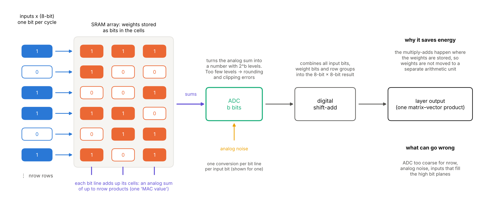
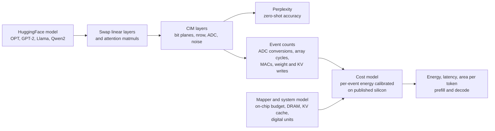
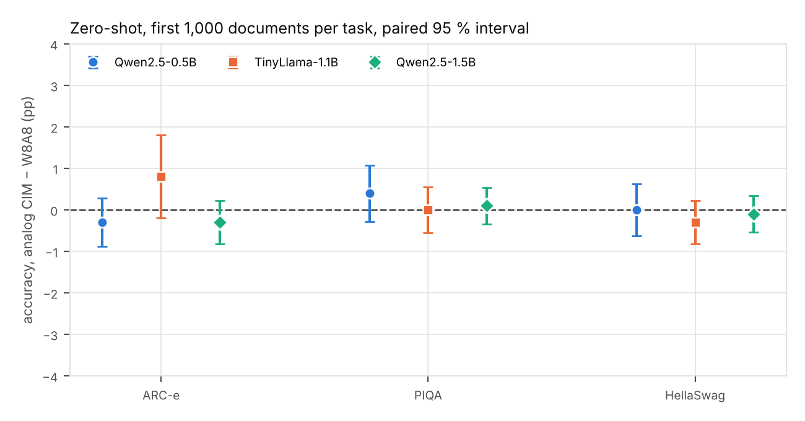
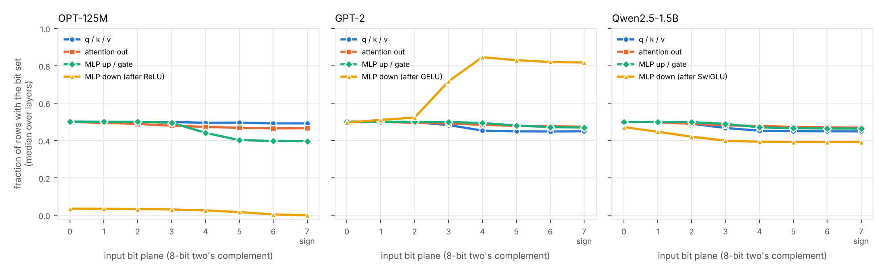
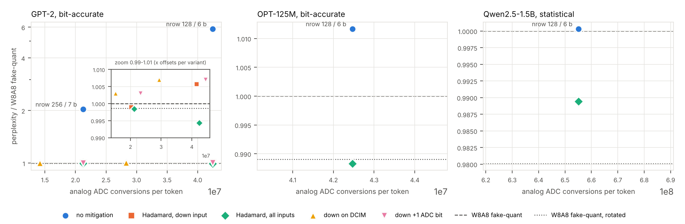

<div align="center">

# SRAM CIM LLM Simulator

**Accuracy and energy of small language models on SRAM compute-in-memory, from one simulation**


<sub>Energy per token for Qwen2.5 at 22 nm. Left: the arithmetic of the linear layers, at equal perplexity.
Right: everything a generated token costs on Qwen2.5-1.5B.</sub>

</div>

---

Large language models spend most of their inference energy on two things: multiply-adds against their
weights, and moving those weights from memory. **SRAM compute-in-memory (CIM)** does the multiply-adds inside
the memory array that stores the weights. In its analog form the energy is low, but the results are
approximate: the array sums currents or charges, and an ADC turns each sum into a number.

This project builds a simulator that answers the two questions that decide whether that is worth doing for an
LLM: **does the model still give the right answers**, and **how much energy does a token actually cost** once
the whole system is counted? It runs real HuggingFace models (OPT, GPT-2, TinyLlama, Qwen2.5) on simulated CIM
hardware, measures perplexity and zero-shot accuracy, and turns the hardware events of the same run into
energy, latency and area for prefill and decode.

> [!NOTE]
> The energy numbers are model estimates calibrated on published silicon, not measurements of a fabricated
> chip. How each part was checked is in [Validation](#validation); what the numbers do not cover is in
> [Interpretation and limits](#interpretation-and-limits).

## Contents

- [Main results](#main-results)
- [How SRAM compute-in-memory works](#how-sram-compute-in-memory-works)
- [What the simulator does](#what-the-simulator-does)
- [Results in detail](#results-in-detail)
- [Design choices and why](#design-choices-and-why)
- [Validation](#validation)
- [Reproducing the results](#reproducing-the-results)
- [Repository layout](#repository-layout)
- [Interpretation and limits](#interpretation-and-limits)
- [License and attribution](#license-and-attribution)

## Main results

| | Result | Evidence |
|---|---|---|
| **Accuracy** | A 6-bit ADC per 128 rows, with a calibrated range, gives the same perplexity as 8-bit digital inference on Qwen2.5-0.5B, TinyLlama-1.1B and Qwen2.5-1.5B (full WikiText-2 test set). Zero-shot accuracy stays within 0.8 pp; no difference is significant. | [`docs/part_a_results.md`](docs/part_a_results.md) §3 |
| **Compute energy** | Analog SRAM CIM needs 2.1× less energy than a conventional digital INT8 datapath for the same work (0.37 vs 0.77 mJ per token, Qwen2.5-1.5B), and 5× less with a state-of-the-art ADC. | [`docs/part_b_results.md`](docs/part_b_results.md) §3 |
| **System energy** | Generating a token costs about 50 mJ on every option. 99 % of it is reading weights from DRAM, because a 1.5B model does not fit on an edge chip. The compute choice only matters for the prompt (prefill). | `results/b4_sweep/` |
| **Where analog breaks** | A layer works when the ADC can resolve one unit of the analog sum: 2^b − 1 ≥ nrow / 2. One bit less and perplexity rises 250–1,100×. | `results/a5s2_*_ba/` |
| **Why some layers need more bits** | The share of 1s in the high input bit planes decides it, not activation outliers. A Hadamard rotation of the input fixes it at no extra ADC cost. | [`docs/findings.md`](docs/findings.md) F15, F16 |
| **Analog noise** | Noise below half an ADC step is absorbed exactly; above that the model fails within a factor of two in noise. | `results/a5n_opt125m/` |

## How SRAM compute-in-memory works



1. Each weight is stored as bits in the SRAM cells; an 8-bit weight uses 8 columns.
2. The input is applied one bit at a time on the rows (word lines).
3. Each column (bit line) adds up the products of its cells in the analog domain. Up to `nrow` rows are summed
   at once.
4. An ADC with `b` bits converts that sum into a number. Its output has only 2^b levels, so a sum of up to
   `nrow` values may be rounded or clipped, and analog noise adds to it.
5. A digital shift-add combines the results of all input bits, weight bits and row groups into the final
   8-bit × 8-bit dot product.

The trade-off in one sentence: summing more rows per conversion means fewer ADC conversions (less energy),
but the sums get larger and need more ADC bits to stay exact. Finding where that breaks for an LLM, and what
it costs, is the purpose of this simulator.

## What the simulator does



- **Accuracy side.** Every linear layer (optionally also the attention matmuls Q·Kᵀ and S·V) is replaced by a
  CIM layer. Two execution modes:
  - *bit-accurate*: every bit plane, row group, ADC conversion and noise sample is computed. Exact, slow.
  - *statistical*: the error each layer makes is computed from a short calibration run and added to an
    ordinary matrix multiply. 6–55× faster, within 2 % of bit-accurate where it is valid. This is what makes
    1.5B-parameter models practical on a laptop CPU.
- **Cost side.** While the model runs, every hardware event is counted. The cost model multiplies the counts by
  per-event energies taken from three published SRAM CIM chips, scaled to 22 nm. A mapper places weights in
  arrays under an on-chip memory budget; the system model adds DRAM traffic for weights that do not fit, the KV
  cache, and the digital units (softmax, normalisation, activation).

## Results in detail

### Energy: where a token's energy goes

Qwen2.5-1.5B, 8-bit weights and activations, 22 nm / 0.8 V, sequence length 512. All options have the same
perplexity (within 0.2 %). The conventional baseline is a digital INT8 datapath on the same node that reads
weights from an on-chip SRAM buffer.

| Per token | Digital INT8 (conventional) | Digital SRAM CIM | Analog SRAM CIM | Analog SRAM CIM, best ADC |
|---|---|---|---|---|
| Compute (linear layers) | 0.77 mJ | 0.19 mJ | 0.37 mJ | 0.15 mJ |
| Prompt token (prefill) | 0.87 mJ | 0.29 mJ | 0.47 mJ | 0.26 mJ |
| Generated token (decode) | 50.5 mJ | 50.2 mJ | 50.4 mJ | 50.2 mJ |

1. **Prefill is compute-bound.** The weights loaded for a prompt are shared by all its tokens, so the compute
   macro decides the cost, and SRAM CIM is 1.8–3.4× cheaper than INT8.
2. **Decode is memory-bound.** Every generated token re-reads 10.5 Gbit of weights from DRAM (41.6 mJ) and the
   LM head (7.4 mJ). The CIM arithmetic is 0.37 mJ, under 1 %. Decoding runs at about 8 tokens/s on one
   12.8 GB/s channel, about 0.4 W.
3. **In analog CIM, the ADC is 63 % of the compute energy** with the ADC of a published macro. A better ADC is
   the largest single compute saving available.
4. **For decode, memory is the lever.** 2 Gbit of weights on chip lowers decode by 16 %. All weights on chip
   gives 7.8 mJ but needs about 2,160 mm² of SRAM cells at 22 nm. Slower GDDR5-class DRAM raises decode to 174 mJ.
5. Qwen2.5-0.5B shows the same pattern: 0.21 → 0.10 mJ compute (INT8 → analog), 16.1 mJ per generated token.

### Accuracy: perplexity and zero-shot

Full WikiText-2 test set, every linear layer on analog CIM (nrow 128, calibrated 6-bit ADC):

| Model | FP32 | 8-bit digital (W8A8) | Analog SRAM CIM |
|---|---|---|---|
| Qwen2.5-0.5B | 13.069 | 13.332 | 13.329 |
| TinyLlama-1.1B | 7.707 | 7.793 | 7.793 |
| Qwen2.5-1.5B | 9.264 | 9.487 | 9.492 |



### Where analog CIM breaks, and why

<table>
<tr>
<td width="50%"></td>
<td width="50%"></td>
</tr>
<tr>
<td><sub><b>ADC bits needed.</b> Most layers work when 2^b − 1 ≥ nrow / 2 and collapse one bit below. GPT-2's
<code>c_proj</code> needs one bit more.</sub></td>
<td><sub><b>Why.</b> A negative input sets every high bit in two's complement. GPT-2 <code>c_proj</code> follows a
GELU and is 82 % small negatives, so its high bit planes are full and its column sums saturate the ADC earlier.</sub></td>
</tr>
<tr>
<td></td>
<td></td>
</tr>
<tr>
<td><sub><b>Fix.</b> Rotating that layer's input with a Hadamard transform spreads the values and removes the extra
bit, at the same number of ADC conversions. Moving it to digital CIM or adding a bit also works, at a higher cost.</sub></td>
<td><sub><b>Noise.</b> Noise below half an ADC step (σ ≤ 0.05 % of full scale) never changes an ADC code.
At 0.10 % codes start to flip and the model degrades sharply.</sub></td>
</tr>
</table>

## Design choices and why

These are the decisions that shaped the tool, with the reasoning behind each. The full list, with dates, is in
[`docs/decisions.md`](docs/decisions.md); every finding referred to (F1–F16) is in
[`docs/findings.md`](docs/findings.md).

1. **Count hardware events inside the forward pass.** Every ADC conversion, array cycle, MAC and memory write is
   counted while the model runs. The cost model then only multiplies counts by costs, so accuracy and energy
   always come from the same run and no second simulation is needed.
2. **Two simulation modes, and the fast one is only used where it has been proven.** Bit-accurate mode
   reproduces ASiM layer by layer, so it can be trusted, but it takes about 74 ms per token on OPT-125M. The
   statistical mode computes each layer's error analytically. It was checked against bit-accurate mode on
   OPT-125M, GPT-2 and Qwen2.5-0.5B, and it is exact only when every calibrated ADC step is 1/n of a MAC unit
   (F13). The run script flags any run outside that region instead of reporting it silently.
3. **Calibrate the ADC range instead of using the full range.** With the full range (the ASiM default), a 6-bit
   ADC destroys OPT-125M: perplexity 12,962. Choosing the full scale per layer that minimises the readout error
   on calibration data lands on exactly one MAC unit per ADC step. It gives 30.8, against 30.4 for 8-bit digital
   (F5). That is worth about one ADC bit, and it is why the 6-bit result above holds.
4. **Explain failures with bit-plane density, not outliers.** The usual explanation for quantisation trouble in
   LLMs is activation outliers. Measuring both showed outliers do not predict which layer needs more ADC bits;
   the fraction of negative inputs does (F15). That predicted that a Hadamard rotation would fix GPT-2's
   `c_proj`, and the bit-accurate run confirmed it (F16).
5. **Take energy from silicon, not from assumptions.** Per-event costs are fitted to three published SRAM CIM
   chips of different kinds: a 65 nm charge-domain macro with an 8-bit SAR ADC (Jia, JSSC 2020), a 7 nm macro
   with a 4-bit flash ADC (Sinangil, JSSC 2021), and a 22 nm digital CIM macro (Chih, ISSCC 2021). The analog
   result system uses the 65 nm macro because it computes the same way as the simulator: bit-serial inputs and
   one ADC conversion per column per input bit.
6. **Report system energy per token, not macro TOPS/W.** A macro efficiency figure only covers the array. For
   an LLM that does not fit on chip, it hides the DRAM traffic that dominates decode, which is the main
   energy result here.
7. **Model the system analytically, then check it against a trace.** Per-token counts are derived from the
   model shape, so any sequence length and memory budget can be costed without rerunning the model. The derived
   counts equal the counted ones exactly: in every Part A run, and in a prefill-plus-decode trace on
   Qwen2.5-1.5B (17 of 17 checks).
8. **Work within a CPU-only budget.** Everything ran on a laptop CPU. Bit-accurate runs use the first 8,192
   test tokens of small models. The result models run in statistical mode, with calibration histograms cached so
   that a sweep over ADC settings costs one calibration.

## Validation

| Check | Result | Evidence |
|---|---|---|
| Layer outputs vs ASiM | ≤ 1e-6 relative error; 7 linear and 14 conv configurations | `tests/test_asim_equivalence.py` |
| ResNet-20 on CIFAR-10 vs ASiM, 13 configurations | within 0.8 % at ADC ≥ 8 bits; within run-to-run spread below | [`validation/asim_repro.md`](validation/asim_repro.md) |
| Statistical vs bit-accurate mode | within 2 % on six configurations including noise; 6–55× faster | `results/a3_gate_summary.md` |
| Energy model vs three published macros | within 13 % in the operating range; 3 stated exceptions | [`validation/macro_calibration.md`](validation/macro_calibration.md) |
| Energy model vs AccelForge (CiMLoop) on the Jia macro | within 4.5 % | [`validation/tool_comparison.md`](validation/tool_comparison.md) |
| Derived event counts vs a counted decode trace | equal, 17 of 17 | `results/b3_trace_qwen15b/` |
| Unit tests | 308 passed (30 need ASiM cloned and are skipped otherwise) | `tests/` |

## Reproducing the results

### Install (CPU)

```bash
git clone https://github.com/thomvs-dev/sram-cim-llm-sim.git
cd sram-cim-llm-sim
python -m venv .venv
source .venv/bin/activate            # Windows: .venv\Scripts\activate
pip install torch --index-url https://download.pytorch.org/whl/cpu
pip install -e ".[llm,eval,dev]"
pytest -q
```

No GPU is needed. To run the ASiM equivalence tests, clone ASiM first:
`git clone https://github.com/Keio-CSG/ASiM third_party/ASiM`.

### Run a model on simulated CIM

```bash
# Qwen2.5-0.5B, every linear layer on analog CIM (statistical mode, calibrated 6-bit ADC, nrow 128)
python scripts/run_ppl.py --model Qwen/Qwen2.5-0.5B --config config/experiments/a4_stat_adc6cal.yaml \
    --name my_qwen05b_cim --max-tokens 8192 --threads 8

# the same model with 8-bit digital arithmetic, for comparison
python scripts/run_ppl.py --model Qwen/Qwen2.5-0.5B --config config/experiments/e0_w8a8.yaml \
    --name my_qwen05b_w8a8 --max-tokens 8192 --threads 8

# energy, latency and area per token for the CIM run (no model is loaded)
python scripts/run_ppa.py --run my_qwen05b_cim --shape config/models/qwen2.5-0.5b.yaml --name my_qwen05b_ppa
```

Each run writes `results/<name>/` with the result, the config, the git commit and the event counts.

<details>
<summary><b>More commands</b>: zero-shot, bit-accurate mode, use from Python</summary>

Zero-shot accuracy (ARC-e, PIQA, HellaSwag through lm-eval-harness):

```bash
python scripts/run_zeroshot.py --model Qwen/Qwen2.5-0.5B --config config/experiments/a4_stat_adc6cal.yaml \
    --name zs_my_run --limit 1000 --threads 8
```

Bit-accurate mode (slow on CPU; use a small model and a token subset):

```bash
python scripts/run_ppl.py --model facebook/opt-125m --config config/experiments/example_bit_accurate.yaml \
    --name opt125m_bit_accurate --max-tokens 8192
```

From Python:

```python
from cimsim import LayerConfigMap, EventCounter, calibrate_adc_range
from cimsim.models.swap import swap_linears

counter = EventCounter()
cfg = LayerConfigMap.from_yaml("config/experiments/example_bit_accurate.yaml")
swap_linears(model, cfg, counter)                      # LM head stays digital
calibrate_adc_range(model, lambda: model(calib_ids))   # if adc_range: calibrated
out = model(input_ids)
print(counter.total())                                 # ADC conversions, array cycles, MACs, ...
```

Simulation modes:

| mode | what runs |
|---|---|
| `fp` | original layer |
| `fake_quant` | integer quantization, normal matmul (ideal digital reference) |
| `bit_accurate` | full bit-plane / ADC / noise simulation (ASiM-compatible) |
| `statistical` | calibrated error injection: analytic gain and noise, exact sparse saturation, discrete ADC code flips |

Everything is set in YAML: quantization, `nrow`, ADC bits and range, noise, which layer types run on analog
CIM, digital CIM or digital logic (`policy:`), attention on CIM, Hadamard rotation. Examples are in
`config/experiments/`. Hardware costs are in `config/circuits/`, `config/macros/` and `config/system/`, and
every cost number is cited in [`docs/assumptions.md`](docs/assumptions.md).

</details>

### Rebuild the figures

All figures are rebuilt from the committed results, without running any model:

```bash
python scripts/make_figures.py                          # figures/*.png
python scripts/b4_sweep.py --name b4_sweep              # energy sweep and figures/b4_energy.png
python scripts/fig_cim_concept.py figures/cim_concept.png
```

## Repository layout

```
cimsim/       the simulator
  core/         bit-plane executors, CIM linear / conv / attention layers, ADC calibration
  stat/         statistical (fast) mode
  circuits/     per-event energy, latency and area models (ADC, array, digital, scaling)
  mapper/       weight placement under an on-chip budget
  system/       model shapes, per-token event counts, DRAM
  ppa/          energy / latency / area per token, prefill and decode
eval/         perplexity and lm-eval-harness wrappers
scripts/      experiment runners and figure scripts
validation/   ASiM reproduction, macro calibration, tool comparison
config/       experiment, circuit, macro, model-shape and system configs
results/      one folder per experiment (config, git commit, raw outputs)
figures/      all figures in this README
docs/         results write-ups, findings, decisions, cost assumptions, design notes
tests/        pytest
```

| Document | Contents |
|---|---|
| [`docs/part_a_results.md`](docs/part_a_results.md) | Accuracy results: ADC, nrow, noise, outliers, mitigation |
| [`docs/part_b_results.md`](docs/part_b_results.md) | Energy, latency and area results |
| [`docs/findings.md`](docs/findings.md) | Findings F1–F16 |
| [`docs/decisions.md`](docs/decisions.md) | Design decisions and their reasons, by date |
| [`docs/assumptions.md`](docs/assumptions.md) | Every modelling assumption and cost number, with its source |
| [`docs/part_a_plan.md`](docs/part_a_plan.md) | Simulator design: bit-plane maths, statistical error model, validation protocols |
| [`docs/cpu_guide.md`](docs/cpu_guide.md) | Running on CPU: speeds and token budgets |

## Interpretation and limits

- **Estimates, not measurements.** Energy comes from per-event costs fitted to published macros and scaled to
  22 nm by the classical rule (energy ∝ node · VDD²). The analog costs rest on a 65 nm macro; the scaling step
  itself is not validated against a 22 nm analog chip.
- **The conventional baseline is modelled**, on the same node and with the same cited digital costs. It is not a
  measured GPU or CPU.
- **DRAM energy is the lowest cited value** (HBM2, 3.97 pJ/bit), so the DRAM share of decode is a lower bound.
- **Area covers SRAM cells only.** ADC and periphery area of the anchor macro is not published.
- **Latency is a bound** set by DRAM bandwidth; operations are not scheduled.
- **Analog noise is a set σ**, not derived from circuit parameters.
- **Statistical mode is only valid where every calibrated ADC step is 1/n MAC unit**; points outside are flagged
  and the results there come from bit-accurate runs on OPT-125M and GPT-2.
- **Models up to 1.5B parameters**, 8-bit weights and activations. The LM head is kept digital and off chip.

## License and attribution

Released under the [Apache License 2.0](LICENSE); see also [`NOTICE`](NOTICE).

- [ASiM](https://github.com/Keio-CSG/ASiM) (Apache 2.0) is the bit-accurate reference the executor was checked
  against. It is not included; clone it to run the equivalence tests.
- [AccelForge](https://github.com/Accelergy-Project/accelforge), the maintained successor of CiMLoop, was used
  for the tool comparison and is not included.
- Calibration macros, from the published papers:
  - H. Jia et al., IEEE JSSC 2020;
  - M. E. Sinangil et al., IEEE JSSC 2021;
  - Y.-D. Chih et al., ISSCC 2021.
- Models and data (OPT, GPT-2, TinyLlama, Qwen2.5, WikiText-2, lm-eval tasks) are downloaded from HuggingFace
  under their own licenses and are not included.
