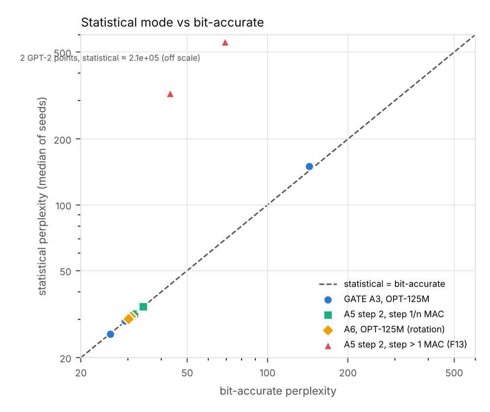
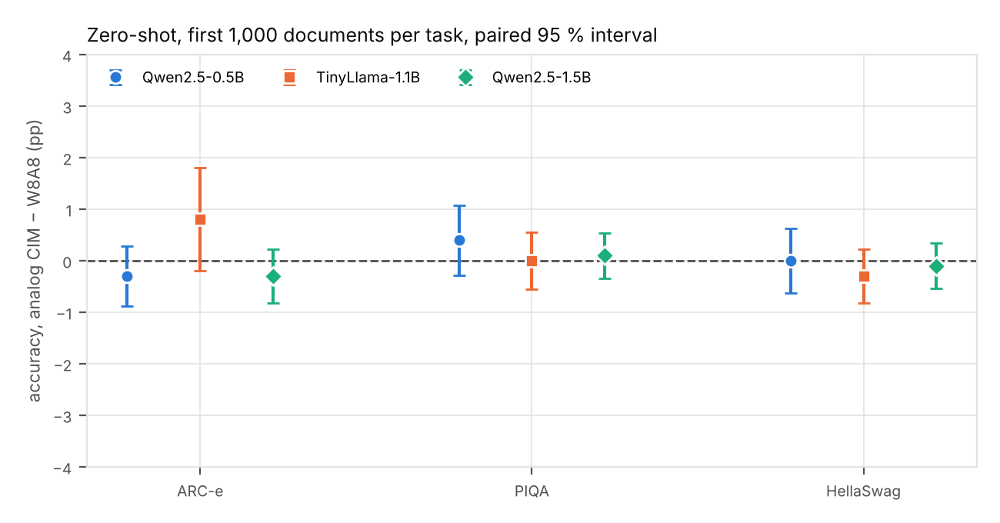
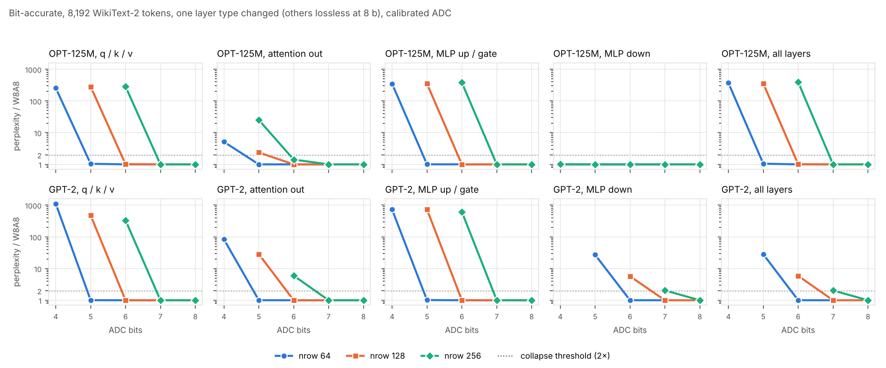
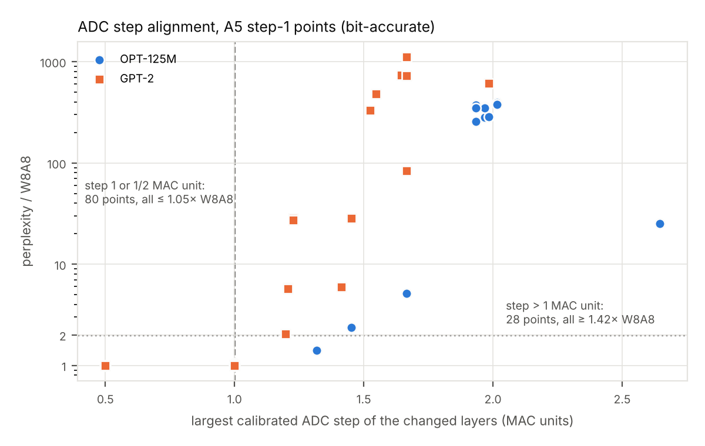
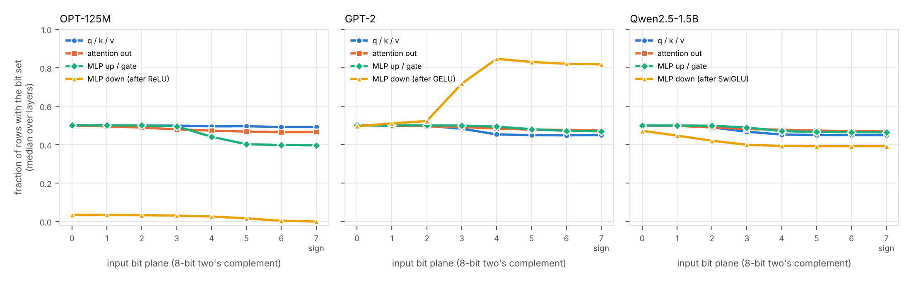
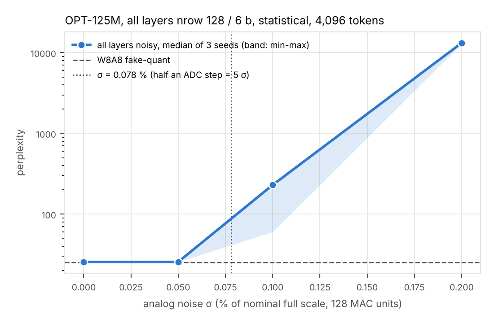
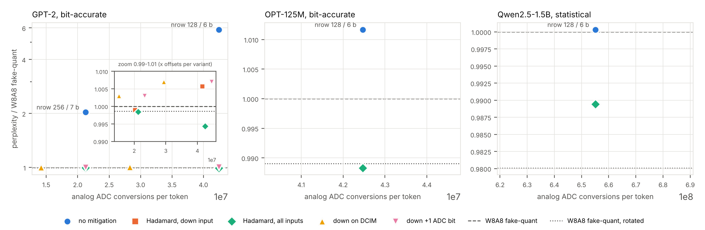

# Part A results: LLM accuracy on SRAM analog compute-in-memory

All numbers are WikiText-2 perplexity (PPL) unless stated otherwise. W8A8 = 8-bit integer fake-quant
(per-channel weights, per-token activations), the digital reference every CIM result is compared with.
Every number has a results folder; the finding numbers (F…) refer to `docs/findings.md`, the
decisions to `docs/decisions.md`. All figures are made by one command from the committed results:

```
python scripts/make_figures.py
```

## 1. Setup

- Simulator: `cimsim`. HuggingFace decoder LLMs with every linear layer (optionally the attention
  matmuls) swapped for an SRAM CIM layer. Weights are bit-sliced into the array (8-bit, two's
  complement); inputs are applied bit-serially; rows are summed in groups of `nrow`. Each group's MAC
  goes through a b-bit ADC, then a digital shift-add.
- Bit-accurate mode reproduces ASiM: layer outputs agree to ≤ 1e-6 relative error, and ResNet-20
  CIFAR-10 accuracy is within 0.8 % at ADC ≥ 8 b (GATE A2, `validation/asim_repro.md`).
- Statistical mode is the fast mode. It computes the error analytically from a calibration MAC
  histogram, with an exact sparse term for ADC saturation and rare noise code flips.
- ADC full scale is calibrated per layer by MSE on 2,048 WikiText-2 train tokens (F5, F12). Event
  counts are produced in every mode: ADC conversions, array cycles, MACs, DCIM ops, KV writes and
  Hadamard additions.
- Models:
  - development models, bit-accurate on the first 8,192 test tokens: OPT-125M and GPT-2;
  - result models, statistical: Qwen2.5-0.5B, TinyLlama-1.1B and Qwen2.5-1.5B.
- Hardware: CPU only (i7-12700H machine, 2-core cloud VM).

## 2. Statistical mode is validated where it is used



- **GATE A3** (OPT-125M, six configs including noise at the cliff): statistical is within
  0.01–1.07 % of bit-accurate on every config. The one chaotic config, at noise σ = 0.10 %, matches on
  medians (+5.0 %, Mann-Whitney p = 0.35). Statistical mode is 6–55× faster
  (`results/a3_gate_summary.md`).
- **A5 step 2**: the eight transition points split cleanly by ADC step.
  - Five points have every calibrated ADC step at 1/n MAC unit. They agree within 0.02 %.
  - Three points have a step above 1 MAC unit. There statistical mode overestimates the error 7.5× to
    3,000× (F13).
  - Statistical mode is therefore used only where every step is 1/n MAC unit. `run_ppl.py` flags any
    other run (`stat_inexact_layers`). All headline results satisfy this.
- **Other checks:**
  - With rotated inputs (A6, OPT-125M), statistical and bit-accurate agree within 0.06 %
    (`results/a6m_opt125m_stat8k_vm/`, `results/a6m_opt125m_ba/`).
  - Qwen2.5-0.5B: 11.994 statistical vs 11.993 bit-accurate (`results/a3g_qwen05b_adc6cal/`).
  - With attention on CIM: 12.043 in both modes (`results/a3g_qwen05b_attn_only_adc6cal/`).

## 3. A calibrated 6-bit ADC at nrow 128 adds no measurable loss on three result models

Full WikiText-2 test set (`results/a4_ppl_full_summary.md`): all linear layers on analog CIM,
statistical mode, nrow 128, calibrated 6-bit ADC.

| Model | FP32 | W8A8 | Analog CIM | analog − W8A8, per-window NLL (nats) |
|---|---|---|---|---|
| Qwen2.5-0.5B | 13.069 | 13.332 | 13.329 | −0.00026 ± 0.00035 |
| TinyLlama-1.1B | 7.707 | 7.793 | 7.793 | −0.00012 ± 0.00019 |
| Qwen2.5-1.5B | 9.264 | 9.487 | 9.492 | +0.00047 ± 0.00042 |



**Zero-shot accuracy** (first 1,000 documents of ARC-e, PIQA and HellaSwag; paired per document;
`results/zs_*_summary.md`): analog CIM − W8A8 is within 0.8 pp on every model and task. All 95 %
intervals contain 0 and every McNemar p ≥ 0.17.

**Attention matmuls on CIM** (Qwen2.5-1.5B, 8,192 tokens):

- analog linear + attention: 10.378;
- ideal 8-bit attention: 10.413;
- attention costs 6.9 % more ADC conversions;
- keys must be quantized per channel (F10; `results/a4_attention_summary.md`).

**Full-range ADC vs calibrated full scale** (bit-accurate, 8,192 tokens, all layers at nrow 128 and the same ADC
bits; full range = ASiM default, full scale = nrow × L; `results/a5f_*_ba/` vs `results/a5s2_*_ba/`):

| ADC | OPT-125M full range | OPT-125M calibrated | GPT-2 full range | GPT-2 calibrated |
|---|---|---|---|---|
| 6 b | 12,662 | 30.816 (+1.2 %) | 70,519 | 198.4 |
| 7 b | 30.614 (+0.5 %) | 30.460 (0.0 %) | 34.985 (+3.6 %) | 33.776 (0.0 %) |
| 8 b | 30.487 (+0.1 %) | 30.460 (0.0 %) | 33.962 (+0.6 %) | 33.776 (0.0 %) |

W8A8 on these tokens is 30.460 for OPT-125M and 33.776 for GPT-2.

- A full-range 6-bit ADC destroys both models. The reason is the two's-complement sign-extension planes with
  coarse ADC steps (F3).
- Calibration picks steps of 1 or ½ MAC unit (F5, F12). That makes 7 and 8 bits exactly lossless and
  OPT-125M usable at 6 b, so it saves about one ADC bit.
- GPT-2 at 6 b still fails even with calibration (198, against 70,519 for full range). Its `c_proj`
  needs a 7-bit ADC (§4) or a rotated input (§5).

## 4. Where the ADC fails: the step of one MAC unit, and the bit-plane density of the input



**Boundary map** (bit-accurate, one layer type changed at a time, the others lossless at 8 b;
`results/a5s2_*_ba/`):

- For q/k/v and MLP up/gate on both models, and all layers on OPT-125M, the layers work if and only if
  2^b − 1 ≥ nrow / 2.
- One bit below that, PPL rises 250–1,100×.
- OPT fc2 works at 4 b for every nrow.
- GPT-2 `mlp.c_proj` needs one bit more: 2^b − 1 ≥ nrow.
- The attention output projection degrades more gradually below the boundary (OPT-125M 1.4–25×, GPT-2 6–83×).



**ADC step alignment** (`scripts/a5_alignment.py`, `results/a5_alignment/summary.md`): across all 108
step-1 points, the calibrated ADC step sorts the points cleanly.

- 80 points have every changed layer at a step of 1 or 1/2 MAC unit. All are within 1.05× of W8A8.
- 28 points have at least one layer at a step above 1 MAC unit (calibration has to clip). All are at
  1.42× or worse.
- The working rule is that the ADC must resolve single MAC units for the column sums the layer
  actually produces.



**Why one layer type needs a bit more** (F15; `scripts/a5_outliers.py`, `results/a5o_*/`):

- In two's complement a negative input code sets every high bit plane.
- GPT-2 `c_proj` follows a GELU. 82 % of its 8-bit inputs are small negatives, so its high planes are
  set on 82 % of rows instead of about 47 %. That raises the column sums and saturates the ADC one bit
  earlier.
- OPT fc2 (after ReLU) has 93 % zero codes and no negatives.
- Activation outliers do not predict the boundary:
  - Qwen2.5-1.5B down_proj has the largest outliers measured: peak/rms per token p99 59, up to 195
    outlier channels.
  - Its sign-plane density is 0.39, and all layers are lossless on the nrow / 2 boundary.

**Result models at the boundary** (statistical, 8,192 tokens, `results/a5r_qwen15b_stat/`):
Qwen2.5-1.5B with all layers at 128 / 6 b gives 10.342, and at 64 / 5 b gives 10.356 (W8A8 10.338).
Both points are on the boundary and both are lossless. Points below the boundary were not run on the
result model (`docs/decisions.md`, 2026-11-14).



**Analog noise** (F14, `results/a5n_opt125m/`):

- With a 1-MAC ADC step, Gaussian noise of σ ≤ 0.05 % of the nominal full scale (0.064 MAC units) is
  absorbed exactly: 25.594 = noise-free on every layer type and seed.
- At σ = 0.10 %, code flips start (about 1e-4 per conversion). PPL then becomes chaotic in both modes:
  with noise on one fc1 layer, bit-accurate gives 52–245 over random streams.
- The design rule is to keep analog noise below about 0.08 %, i.e. half an ADC step is ≥ 5σ.
- A per-layer-type noise ranking is not reported, because statistical mode is not validated at the
  cliff for single layer types (`docs/decisions.md`).

## 5. Mitigation at equal ADC cost: rotate the one dense input



`scripts/a6_mitigation.py`, `results/a6m_*/`, F16. PPL / W8A8:

| | GPT-2 128 / 6 b | GPT-2 256 / 7 b | OPT-125M 128 / 6 b | Qwen2.5-1.5B 128 / 6 b |
|---|---|---|---|---|
| no mitigation | 5.873 | 2.037 | 1.012 | 1.000 |
| Hadamard on the down-projection input | 1.006 | 0.999 | – | – |
| Hadamard on all inputs | 0.994 | 0.998 | 0.988 | 0.989 |
| down projection on DCIM (⅓ of conversions moved to DCIM) | 1.007 | 1.003 | – | – |
| down projection +1 ADC bit | 1.007 | 1.003 | – | – |

- Rotating the input of the one layer type whose high bit planes are dense removes GPT-2's extra
  ADC bit. It keeps the same number and size of ADC conversions. The cost is 3.7e5 digital additions
  per token, against 4.2e7 conversions per token.
- On models that are already lossless (OPT, Qwen), rotation only brings the gain it gives to 8-bit
  quantization:
  - Qwen2.5-1.5B rotated W8A8 is 10.133.
  - Analog with rotation is 10.229, +0.9 % above rotated W8A8.
- Rotation does not move the nrow / 2 boundary, because those inputs already have sign-plane density
  of about 0.5.

## 6. Limits

- Bit-accurate whole-model runs are limited to OPT-125M and GPT-2 on 8,192 tokens (CPU).
- The result models are checked at two boundary points only.
- Statistical mode is valid only at ADC steps of 1/n MAC unit (F13).
- Noise is user-specified Gaussian / nonlinear, not derived from circuit parameters. A7 is deferred.
- The following were deferred for the deadline (`docs/decisions.md`, 2026-11-11):
  - bit-serial vs bit-parallel inputs;
  - input encoding (sign-magnitude / offset inputs, which F15 suggests would remove the GELU effect);
  - SmoothQuant;
  - noise-aware fine-tuning;
  - channel-level hybrid.
- Hardware cost (energy / latency / area) is Part B and is not in these results.
